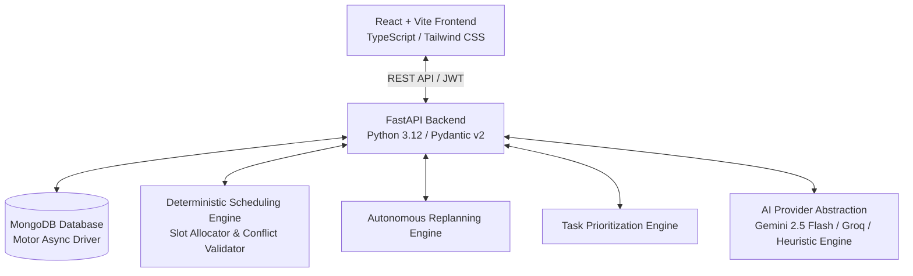

# TaskFlow AI — Intelligent Daily Task Planner Agent

TaskFlow AI is a production-grade, full-stack autonomous daily task planning agent designed for students, developers, professionals, and individuals to organize work, manage time, meet deadlines, and conquer procrastination.

---

## 🌟 Key Features & Agent Capabilities

### 1. Intelligent Task Creation (Natural Language + Structured Form)
- **Conversational Task Parsing**: Speak or type naturally (e.g. *"Complete DBMS notes for two hours tomorrow at 3 PM"*). The Task Understanding Agent extracts:
  - Title and category (`study`, `coding`, `work`, `health`, `errand`, `personal`)
  - Estimated duration and priority rating
  - Due date and preferred time slot
  - Energy demand (`high`, `medium`, `low`) and recurrence rules
- **Confirmation Preview Card**: Displays extracted attributes with a confidence rating before saving. Never silently guesses deadlines.
- **Detailed Form**: Manual task editor with subtasks, importance, urgency ratings, and recurrence.

### 2. Deterministic Prioritization Engine
- Combines urgency, importance, effort, dependency blockers, and deadline proximity into a transparent **Priority Score (0–100)**.
- Classifies tasks into Eisenhower-aligned buckets:
  - 🚨 **Critical & Urgent** (imminent deadlines or high priority)
  - 🎯 **Important Not Urgent** (high-leverage strategic work)
  - ⚡ **Quick Wins** (high-impact tasks under 20 minutes)
  - 🔄 **Routine** (recurring habits)
  - ⏸️ **Optional / Deferrable**

### 3. AI Daily Planning Agent
- Generates conflict-free daily time-blocked schedules respecting working hours, lunch breaks, and fixed commitments.
- Three specialized planning modes:
  - **Balanced Mode**: Optimal pacing with regular cognitive rest breaks and quick-win momentum.
  - **Focus Mode**: Extended uninterrupted blocks (up to 90 min) reserved for deep work.
  - **Deadline Mode**: Strict chronological prioritization of approaching due dates.
- **"Why this plan?" Explanation**: Synthesizes rationales for why each block was placed at its specific time.
- **Overload Protection**: If your day has insufficient hours, it clearly flags unscheduled tasks with actionable recommendations instead of overloading you.

### 4. Autonomous Dynamic Replanning Agent
- Adapts when tasks take longer than expected, sessions are missed, or new urgent items appear.
- **Preserves Completed Work**: Never deletes finished milestones or alters fixed commitments.
- Recalculates remaining daily capacity from current time and shifts pending work into conflict-free slots.
- Produces a clear audit trail of all changes made.

### 5. AI Productivity Chat Assistant
- Conversational copilot grounded in your authorized live database.
- Answers: *"What should I do next?"*, *"I have only 2 hours left. What can I finish?"*, *"Plan my day"*, *"Reschedule unfinished tasks"*.
- Emits **Proposed Action Cards** with 1-click execution.

### 6. Smart Goal Breakdown Agent
- Deconstructs high-level objectives (e.g. *"Prepare for DBMS examination"*, *"Build a full-stack portfolio"*) into 5–7 ordered subtasks with time estimates and verifiable completion criteria.

### 7. Focus Timer & Pomodoro Tracker
- Pomodoro presets (25m/5m, 50m/10m, custom duration).
- Direct task linkage: Automatically records actual minutes worked to the task.
- Audio cues, celebratory confetti on finish, and optional browser notifications.

### 8. Analytics & Reports
- Real-time productivity index with a transparent formula: `40% Completion + 25% Focus Time + 10% Planning Activity - Overdue Penalty`.
- Category distribution charts (Recharts).
- Planned vs actual duration comparisons.
- 7-day completion velocity trends.

### 9. Privacy, Data Sovereignty & Settings
- Dark & Light mode themes.
- Configurable working hours and fixed commitments (e.g. classes, meetings, lunch).
- **1-Click Personal Data Export**: Download complete JSON archive of all tasks, schedule blocks, focus logs, and daily reviews.
- **Account Deletion**: Complete GDPR-compliant purge of all user records.

---

## 🏗️ Technical Architecture



### Stack Components:
- **Frontend**: React 18/19, Vite, TypeScript, Tailwind CSS, Lucide Icons, Framer Motion, Recharts, Canvas-Confetti.
- **Backend**: Python 3.12, FastAPI, Pydantic v2, Motor (Async MongoDB), PyJWT, Bcrypt, HTTPX, Uvicorn.
- **Database**: SQLite (Default zero-config embedded file `taskflow.db` requiring no external server) or optional MongoDB Atlas.
- **AI Engine**: Google Gemini API (`google-genai` / `gemini-2.5-flash`), Groq API (`llama-3.3-70b-versatile`), with built-in heuristic offline intelligence fallback.

---

## 🚀 Quickstart & Running Instructions

### Prerequisites
- **Node.js** (v18+) and **npm**
- **Python** (3.10+)
- *No database installation required! SQLite runs embedded out of the box.*

---

### Step 1: Start Backend

1. Open a terminal in `backend/`:
   ```bash
   cd backend
   ```
2. Activate virtual environment:
   - **Windows Powershell**:
     ```powershell
     .\venv\Scripts\Activate.ps1
     ```
   - **Linux / macOS**:
     ```bash
     source venv/bin/activate
     ```
3. Install dependencies:
   ```bash
   pip install -r requirements.txt
   ```
4. Start the FastAPI server:
   ```bash
   uvicorn app.main:app --host 127.0.0.1 --port 8000 --reload
   ```
   *The backend will be live at `http://127.0.0.1:8000`.*
   *Interactive API Docs available at `http://127.0.0.1:8000/docs`.*

---

### Step 2: Start Frontend

1. Open a new terminal in `frontend/`:
   ```bash
   cd frontend
   ```
2. Install dependencies:
   ```bash
   npm install
   ```
3. Start the Vite dev server:
   ```bash
   npm run dev -- --host 127.0.0.1 --port 5173
   ```
   *The web application will be live at `http://127.0.0.1:5173`.*

---

## ⚙️ Configuration & Environment Variables

Copy `backend/.env.example` to `backend/.env`:

```env
PROJECT_NAME="TaskFlow AI"
SECRET_KEY="your-super-secret-jwt-key"

# Database (SQLite is default: zero-config, embedded, works out of the box)
DATABASE_TYPE="sqlite"
SQLITE_PATH="taskflow.db"

# Optional: External MongoDB Atlas
# DATABASE_TYPE="mongodb"
# MONGODB_URI="mongodb+srv://<username>:<password>@cluster0.abcde.mongodb.net/taskflow_ai?retryWrites=true&w=majority"

# Optional AI Providers:
# Set your Gemini API Key to activate Google Gemini 2.5 Flash:
GEMINI_API_KEY=""

# Or set Groq API Key:
GROQ_API_KEY=""

AI_PROVIDER="gemini"
```

> **Note on AI Keys**: TaskFlow AI includes an advanced deterministic heuristic engine for NLP parsing, goal decomposition, schedule generation, and context coaching. The app is **100% functional and testable immediately** even if no external API key is set. When an API key is provided in `.env` or in the user's **Settings Page**, TaskFlow AI automatically upgrades to the full LLM agent pipeline!

---

## 🧪 Running Automated Tests

Run the backend test suite:
```bash
cd backend
venv\Scripts\python -m pytest app/tests
```
*Tests cover password hashing, JWT security, deterministic priority scoring, slot scheduling with fixed commitments, autonomous replanning, and NLP parsing.*

---

## 🚢 Deployment Guide

- **Frontend (Vercel / Cloudflare Pages / Netlify)**:
  - Root directory: `frontend/`
  - Build command: `npm run build`
  - Output directory: `dist`
  - Environment variable: `VITE_API_BASE_URL=https://your-backend.onrender.com/api`

- **Backend (Render / Railway / Fly.io)**:
  - Root directory: `backend/`
  - Build command: `pip install -r requirements.txt`
  - Start command: `uvicorn app.main:app --host 0.0.0.0 --port $PORT`
  - Environment variables: `MONGODB_URI`, `SECRET_KEY`, `GEMINI_API_KEY`

- **Database (MongoDB Atlas)**:
  - Create a free M0 cluster on MongoDB Atlas.
  - Set `MONGODB_URI="mongodb+srv://<username>:<password>@cluster0.mongodb.net/taskflow_ai?retryWrites=true&w=majority"` in backend environment variables.

---

## 📋 Comprehensive Feature Checklist

| Feature Area | Status | Verification Detail |
|---|---|---|
| **User Authentication & Profiles** | ✅ Complete | Secure bcrypt password hashing, JWT stateless bearer auth, onboarding wizard with role & preference customization. |
| **Intelligent Task Creation** | ✅ Complete | Conversational natural language parsing + structured modal with energy level, recurrence, urgency, and importance. |
| **Deterministic Prioritization Engine** | ✅ Complete | 0–100 transparent formula calculating deadline proximity, importance, urgency, effort, and dependency blockers. |
| **AI Daily Planning Agent** | ✅ Complete | Dynamic time-block scheduler respecting working hours, commitments, and breaks across 3 modes (Balanced, Focus, Deadline). |
| **Autonomous Dynamic Replanner** | ✅ Complete | Recalculates remaining time, preserves completed work, shifts pending blocks, and logs audit trail. |
| **AI Productivity Chat Assistant** | ✅ Complete | Live database-grounded chat assistant with action cards and suggested prompt pills. |
| **Smart Goal Breakdown** | ✅ Complete | Deconstructs big goals into 5–7 actionable subtasks with time estimates and criteria. |
| **Focus Timer & Pomodoro** | ✅ Complete | 25m/5m, 50m/10m, custom timers, real duration logging directly into task records. |
| **Multi-View Calendar** | ✅ Complete | Day, Week, and Month views aggregating scheduled blocks and deadlines with quick navigation. |
| **Analytics & Productivity Score** | ✅ Complete | Recharts category donut, planned vs actual duration bars, and formula breakdown. |
| **Privacy, Export & Account Purge** | ✅ Complete | Full JSON archive download and GDPR-compliant cascading account deletion. |
| **Dual Theme Support** | ✅ Complete | Warm Ivory light theme and modern sleek dark mode with persistent user preference. |

---

## 👤 Pre-Seeded Demo Account

You can register any new account on the onboarding page, or test immediately with the seeded demo profile:
- **Email**: `demo.student@taskflow.ai`
- **Password**: `TaskFlowDemo2026!`
- **Role**: Student & Developer with pre-loaded realistic study, coding, and health tasks.
